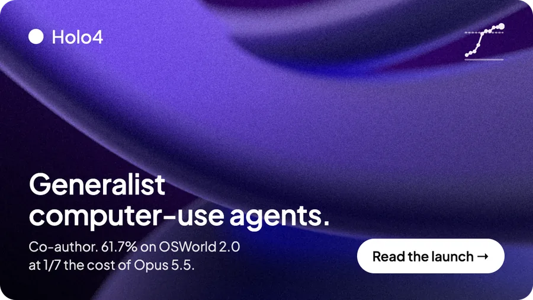
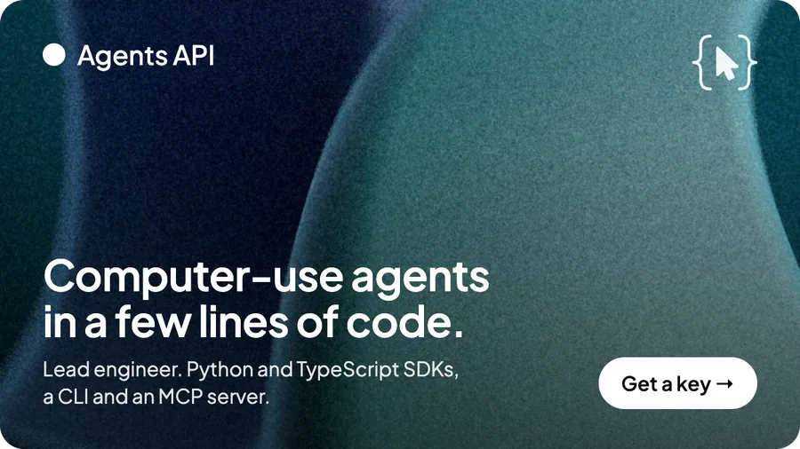
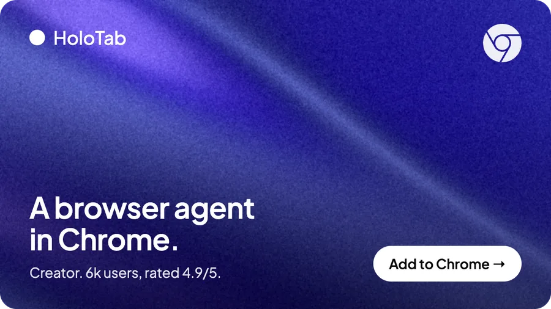
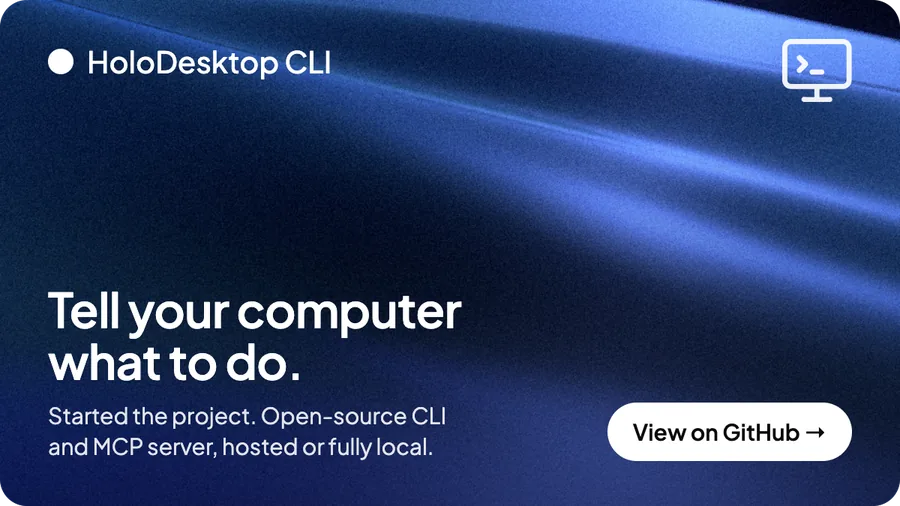
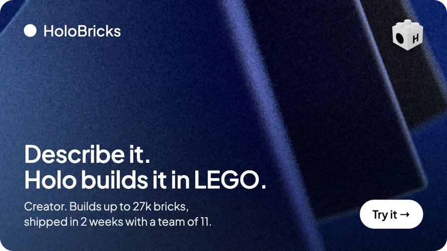
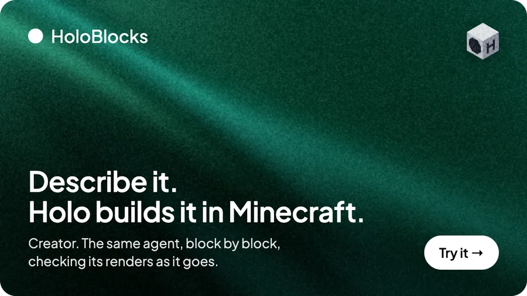
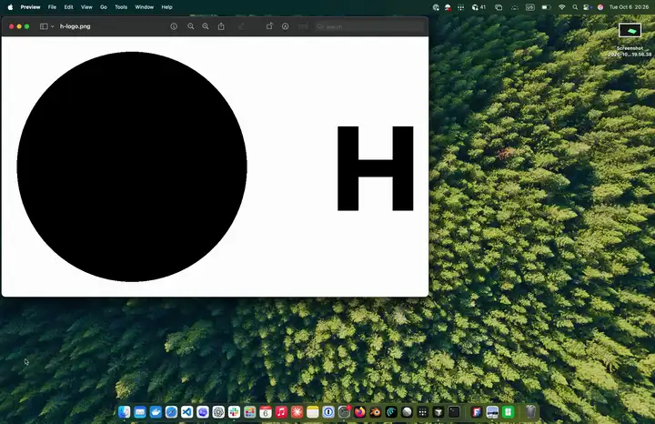

## Antoine Bonnet

Research engineer on computer-use agents at [H Company](https://hcompany.ai), Paris. Creator of H's agent harness, used to evaluate and train the Holo models, and lead engineer of the H Agents API.

 
 
 

Holo4 models a part in FreeCAD, then slices it for a Bambu Lab printer ([full video](figs/holo4-design-print.mp4)):

### Projects

- [Holo3](https://hcompany.ai/newsroom/holo3) and [Holo3.1](https://hcompany.ai/newsroom/holo3.1): data collection on H's agent harness, integration into HoloTab and the Agents API, and the Holo3.1 launch post.
- [Agents API](https://hub.hcompany.ai/agents-api/introduction) (lead engineer): H's public computer-use API, with SDKs, a CLI and an MCP server.
- [HoloTab](https://hcompany.ai/newsroom/meet-holotab) (creator): a browser agent in Chrome, 6k users.
- [HoloBricks](https://bricks.hcompany.ai) and [HoloBlocks](https://blocks.hcompany.ai) (creator): agents that build LEGO and Minecraft models from a prompt and check their renders as they go.
- [HoloDesktop CLI](https://hcompany.ai/newsroom/holodesktop-cli): a desktop agent in the terminal.
- [Surfer 2](https://arxiv.org/abs/2510.19949): state of the art on OSWorld, WebVoyager, WebArena and AndroidWorld in 2025.

### Open source

| Repo | What |
|---|---|
| [hcompai/hai-agents-python](https://github.com/hcompai/hai-agents-python) | Python SDK and agent harness for Holo models |
| [hcompai/hai-agents-ts](https://github.com/hcompai/hai-agents-ts) | TypeScript SDK for the Agents API |
| [hcompai/holo-desktop-cli](https://github.com/hcompai/holo-desktop-cli) | Desktop agent in the terminal |
| [hcompai/holobricks](https://github.com/hcompai/holobricks) | LEGO builder agent |
| [epfLLM/meditron](https://github.com/epfLLM/meditron) | Open medical LLMs, 2.2k stars |

### Activity

Most work happens in private H repos under the work account [@abonneth](https://github.com/abonneth): 10.9k contributions in the past year.

### Before H

- Meta GenAI, research intern: hierarchical multi-agent systems, and fine-tuning Llama 3.1 70B on its own successful runs.
- [Meditron](https://arxiv.org/abs/2311.16079), data lead at EPFL: open medical LLMs built on Llama 2, plus the [Clinical Guidelines](https://huggingface.co/datasets/epfl-llm/guidelines) dataset. Featured on the [Meta AI blog](https://ai.meta.com/blog/llama-2-3-meditron-yale-medicine-epfl-open-source-llm/).
- [MOOVE](https://jointhemoove.org): a platform where clinicians rate medical LLM answers.

MSc in Computer Science, EPFL. BSc in Math and Computer Science, McGill.

[Google Scholar](https://scholar.google.com/citations?user=Xt__74QAAAAJ) · [LinkedIn](https://www.linkedin.com/in/antoine-bonnet04) · [Resume](CV.pdf)
