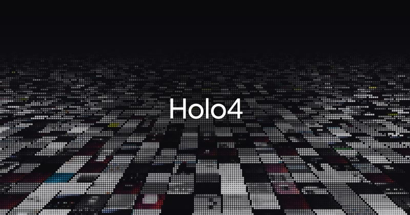
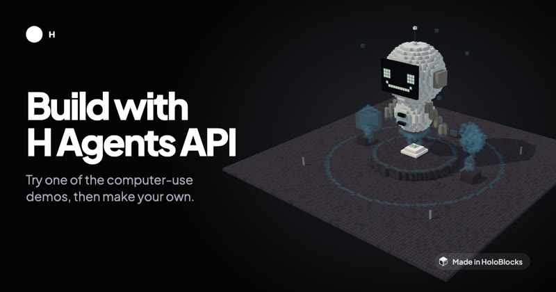
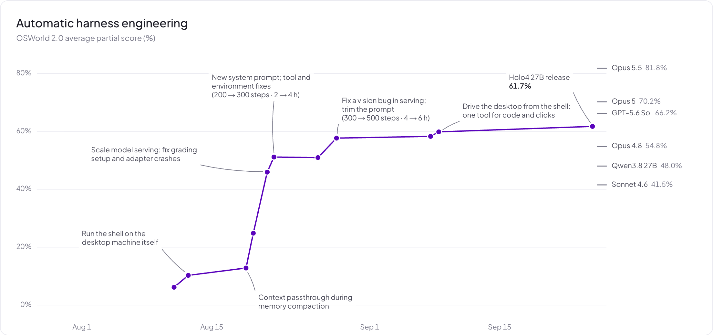
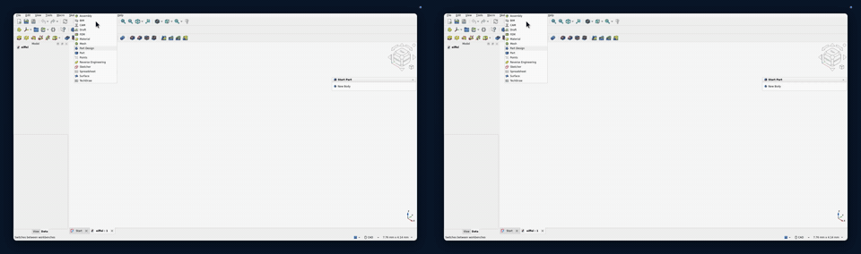

## Antoine Bonnet

Research engineer on computer-use agents at [H Company](https://hcompany.ai), Paris. Creator of SAgent, the agent harness used to evaluate and train the Holo models, and lead engineer of the H Agents API.

  
  
  

### Harness engineering with agents

For [Holo4](https://hcompany.ai/newsroom/holo4), agents analyzed failed OSWorld 2.0 runs, diagnosed each failure and proposed harness fixes, each reviewed by hand before merging. In one month, without finetuning, the score rose from 6.1% (Qwen3.6 27B) to 59.8%. On the same Qwen3.8 27B weights: 24.8% → 45.9% → 51.1% → 57.6% → 59.8%, above the 48.0% Alibaba reports for this model. The largest gains came from memory that holds over hundreds of steps and a shell on the desktop machine.

Holo4 27B (left) and its base model Qwen3.8 27B (right) build the Eiffel Tower in FreeCAD, with the same prompt and harness.

### Projects

- [Holo3](https://hcompany.ai/newsroom/holo3) and [Holo3.1](https://hcompany.ai/newsroom/holo3.1): data collection on SAgent, integration into HoloTab and the Agents API, and the Holo3.1 launch post.
- [Agents API](https://hub.hcompany.ai/agents-api/introduction) (lead engineer): H's public computer-use API, with SDKs, a CLI and an MCP server.
- [HoloBricks](https://bricks.hcompany.ai) and [HoloBlocks](https://blocks.hcompany.ai): describe a model and an agent builds it in LEGO or Minecraft, checking its renders as it goes. Live demos.
- [HoloTab](https://hcompany.ai/newsroom/meet-holotab): a browser agent in Chrome.
- [HoloDesktop CLI](https://hcompany.ai/newsroom/holodesktop-cli): a desktop agent in your terminal.
- [Surfer 2](https://arxiv.org/abs/2510.19949): state of the art on OSWorld, WebVoyager, WebArena and AndroidWorld in 2025.

### Open source

| Repo | What |
|---|---|
| [hcompai/hai-agents-python](https://github.com/hcompai/hai-agents-python) | Python SDK and agent harness for Holo models |
| [hcompai/hai-agents-ts](https://github.com/hcompai/hai-agents-ts) | TypeScript SDK for the Agents API |
| [hcompai/holo-desktop-cli](https://github.com/hcompai/holo-desktop-cli) | Desktop agent in your terminal |
| [hcompai/holobricks](https://github.com/hcompai/holobricks) | LEGO builder agent |
| [epfLLM/meditron](https://github.com/epfLLM/meditron) | Open medical LLMs, 2.2k stars |

### Activity

Most work happens in private H repos under the work account [@abonneth](https://github.com/abonneth): 10.9k contributions in the past year.

### Before H

- Meta GenAI, research intern: hierarchical multi-agent systems, and fine-tuning Llama 3.1 70B on its own successful runs.
- [Meditron](https://arxiv.org/abs/2311.16079), data lead at EPFL: open medical LLMs built on Llama 2, plus the [Clinical Guidelines](https://huggingface.co/datasets/epfl-llm/guidelines) dataset. Featured on the [Meta AI blog](https://ai.meta.com/blog/llama-2-3-meditron-yale-medicine-epfl-open-source-llm/).
- [MOOVE](https://jointhemoove.org): a platform where clinicians rate medical LLM answers.

MSc in Computer Science, EPFL. BSc in Math and Computer Science, McGill.

[Google Scholar](https://scholar.google.com/citations?user=Xt__74QAAAAJ) · [LinkedIn](https://www.linkedin.com/in/antoine-bonnet04) · [Resume](CV.pdf)
